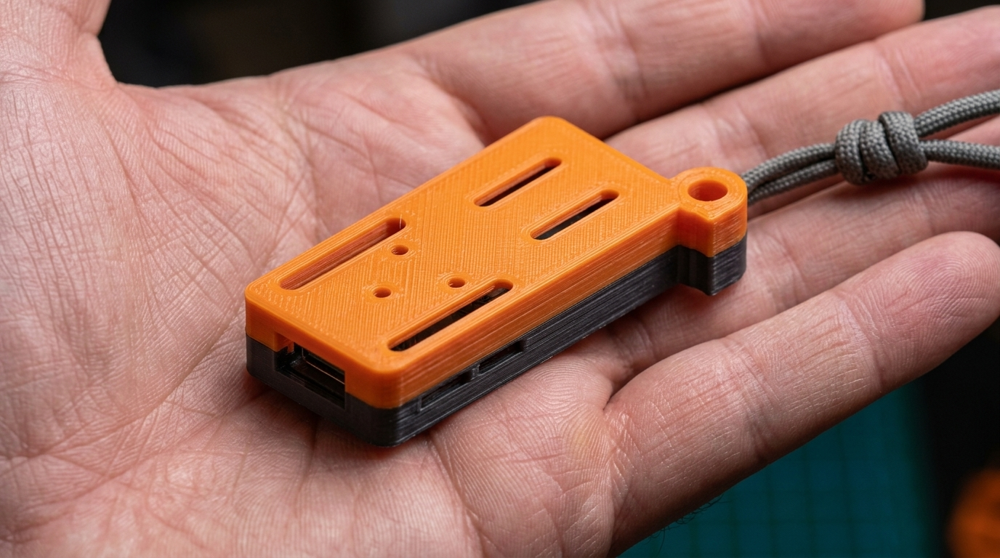

# ⚡ XiaoVault Survival Wiki

[](https://everyday3d.github.io/xiaovault-survival-wiki/)
[-blue?style=for-the-badge)](models/README.md)
[](LICENSE)

<p align="center">
  
</p>

<h3 align="center">When the grid goes down, the answers don't have to.</h3>

<p align="center">
A survival library in your pocket, on a $5 board. It makes its own Wi-Fi network, so any phone can read it.<br>
No internet. No cell service. No app. No subscription. Plug it into a power bank and connect.
</p>

## What you get

| | |
| :--- | :--- |
| 📖 **118 field guides** | Water, fire, shelter, first aid, weather, vehicles, home, radio, kids and family, hygiene and more, in 15 categories. Plain language, written for stressed people with cold hands. The same library as the [ESP32 CYD Survival Wiki](https://github.com/everyday3d/esp32-cyd-survival-wiki). |
| 🔎 **Search that knows keywords** | Type "cpr", "tick" or "burn" and get the right guide. Search matches titles and keywords. Every word has to match, and title matches come first. |
| 🗂️ **Category tiles** | A tile for each category with a guide count. Tap one to see its guides. |
| 🔗 **Linked guides and pictures** | Guides point to each other ("see Shock"), and 22 line drawings show knots, shelters, CPR and more. |
| 🚨 **Works with no SD card** | CPR, severe bleeding, water purification, the Rule of Threes and Morse code are stored in the board's own flash memory. |
| 📱 **Phone hotspot** | Connect to the `XiaoVault Survival Wiki` network and a captive portal opens the reader. Bookmarks stay on your phone. |
| 🔋 **Runs on a power bank** | Any USB-C power bank will do. A keep-alive pulse stops smart banks from switching off on a low load. |
| 🖨️ **Printable case** | Zero-support snap-fit case with a rear microSD slot and a keyring loop. STEP and FreeCAD files included. |

<div align="center">

| 🔍 Home and search | 📖 Reader |
| :---: | :---: |
|  |  |

</div>

> [!NOTE]
> **Upgrading from 1.0?** Re-flash the board, then copy the new [`sd_card/wiki/`](sd_card/wiki/) folder onto your card. The index format changed, so an old card only shows the built-in flash guides until you do. See the [changelog](CHANGELOG.md).

---

## Quick start

You need a **Seeed Studio XIAO ESP32-C6**, a **microSD breakout** wired to it (see [Wiring](#wiring)), and a **FAT32 or exFAT microSD card**. The full parts list is in [`docs/HARDWARE.md`](docs/HARDWARE.md), and the whole build comes to roughly $12 to $18 if you already own a power bank.

### 1. Flash the board

Open the **[web flasher](https://everyday3d.github.io/xiaovault-survival-wiki/)** in Chrome, Edge or Brave, plug in the XIAO with a USB-C data cable, click **Connect & Flash**, and pick the COM port. It takes under a minute.

Prefer a toolchain?

```bash
git clone https://github.com/everyday3d/xiaovault-survival-wiki.git
cd xiaovault-survival-wiki
pio run -e seeed_xiao_esp32c6 -t upload     # PlatformIO
pio device monitor -b 115200                # optional serial log
```

Arduino IDE also works: install the ESP32 board package and the **ArduinoJson 7** library, choose **ESP32C6 Dev Module**, open `src/main.cpp` and upload.

### 2. Fill the SD card

Copy the ready-made [`sd_card/wiki/`](sd_card/wiki/) folder to the root of the card:

```text
MicroSD card root
└── wiki/
    ├── wiki.idx        binary index
    ├── wiki.dat        guide text
    ├── search.tsv      keywords for search
    ├── categories.tsv  home screen tiles
    └── img/            pictures used by the guides
```

### 3. Connect

Power the board, join the **XiaoVault Survival Wiki** Wi-Fi network (it's open, no password) and the reader opens by itself. If it doesn't, browse to `http://192.168.4.1/`.

---

## Make your own guides

Every guide is a Markdown file in [`guides/`](guides/) with a few lines of front matter:

```text
---
title: Burns
category: firstaid
tags: burns, scald, blisters
summary: Cool the burn, cover it, and know when it is serious.
---
## Cool it
- Cool with clean, cool running water for **20 minutes**.
```

- `category` is an id from [`guides/categories.tsv`](guides/categories.tsv).
- Titles must be unique and are cut at 56 bytes. If two guides share a title, the builder adds the category name to tell them apart.
- Link to another guide with `[Shock](shock.md)`. Put pictures in `guides/img/` and use ``.

Then rebuild (Python 3, no extra packages):

```bash
python tools/build_wiki_sd.py                                    # guides/ -> sd_card/wiki/
python tools/build_wiki_sd.py --input my_guides --output E:/wiki   # straight to the card
```

Plain Markdown, HTML or text files with no front matter work too. They show up under their file name with no category.

---

## How it works

```
   Phone / laptop  ──  open Wi-Fi "XiaoVault Survival Wiki"  ──►  Seeed XIAO ESP32-C6
                                                                   │
        captive portal DNS (port 53)  ·  web server (port 80)  ·  power manager
                                                                   │
        flash: 5 emergency guides, always available                │
        SD card (SPI): wiki.idx + wiki.dat + search.tsv + categories.tsv + img/
```

- The web app is one small page stored in flash. It asks the board for search results, categories and guides as JSON or HTML.
- `wiki.idx` is sorted by title, so opening a guide is a binary search. Wikis of up to 4,000 guides also get keyword search and category counts. Bigger ones fall back to prefix search on titles.
- Source files: [`src/`](src/) for the firmware, [`tools/build_wiki_sd.py`](tools/build_wiki_sd.py) for the card builder.

---

## Printable case

The **Tandem** case holds the XIAO and a microSD breakout end to end in a 21.0 × 44.5 × 9.4 mm pocket profile.


- Prints flat with no supports.
- Rear push-push slot to swap the microSD card without opening the case.
- Split U-notch for the USB-C plug, 8 click-lock detents and a 4 mm keyring loop.
- STEP files and the master FreeCAD project are in [`models/`](models/) so you can adapt it to other breakouts. There is also an OpenSCAD customizer.

---

## Wiring

| XIAO pin | ESP32-C6 GPIO | microSD pin | Wire (typical) |
| :--- | :--- | :--- | :--- |
| **3V3** | 3.3 V | VCC | Red |
| **GND** | Ground | GND | Black |
| **D8** | `GPIO 19` | SCK / CLK | Yellow |
| **D9** | `GPIO 20` | MISO / DO | Green |
| **D10** | `GPIO 18` | MOSI / DI | Blue |
| **D2** | `GPIO 2` | CS | White |

Battery sensing and the optional voltage divider are covered in [`docs/WIRING.md`](docs/WIRING.md).

---

## Contributing and credits

Found a typo in a guide, or want a new one? Open an issue or a pull request against the files in [`guides/`](guides/). Please keep guides in plain language and put the most urgent step first.

Released under the [MIT License](LICENSE). Made with 🐾 for makers, hikers and anyone who wants to be ready, by **everyday3d / BoxerDawg 3D**.

> These guides are general information, not medical advice. In an emergency, call your local emergency number whenever you can.
